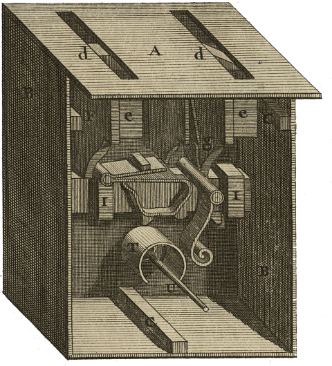

<div align="center" id="head">


<table>
<tr>
<td></td>
<td align="left">
<h1 style="margin:0">Tradomatic</h1>
<p style="margin:0.25em 0 0"><strong>Autonome Übersetzung · Intelligentes Glossar</strong><br/>Empfohlenes Profil: Philosophie DE → FR · Claude / Gemini · PyQt6</p>
</td>
</tr>
</table>

<a href="https://atelier.atechnologie.fr/" title="l'Atelier – Verein für Buchherstellung und Forschungswerkzeuge"></a>  
<sub>Entwickelt von <a href="https://atelier.atechnologie.fr/">l'Atelier</a> — Buchherstellung und Forschungswerkzeuge (EHESS)</sub>

<p>
🇫🇷 <a href="README.md">Français</a> ·
🇬🇧 <a href="README.en.md">English</a> ·
🇩🇪 <a href="README.de.md"><b>Deutsch</b></a> ·
🇪🇸 <a href="README.es.md">Español</a>
</p>

<p>
<a href="https://atelier.atechnologie.fr/"></a>
<a href="https://github.com/Atelier-Recherche/tradomatic"></a>
</p>

</div>

---

## 📸 Vorschau

| Übersetzung | Glossar |
| :---: | :---: |
|  |  |

---
## 📖 Über

Autonomer Textübersetzer mit intelligentem terminologischem Glossar. Sprachen und Fachgebiet sind konfigurierbar — empfohlenes Profil: Philosophie Deutsch → Französisch.

---

## ⬇️ Installation

```bash
# Windows
python -m venv venv
venv\Scripts\activate
pip install -r requirements.txt

# Linux/Mac
python -m venv venv
source venv/bin/activate
pip install -r requirements.txt
```

---

## ✏️ Verwendung

```bash
python src/main.py
```

---

## ⚙️ Konfiguration

1. **Einstellungen**: API wählen (Claude/Gemini), Quell-/Zielsprache, Profil (z. B. Philosophie DE → FR), API-Schlüssel eingeben, Verbindung testen, Pfade setzen
2. **Prompts**: Prompts anpassen (Platzhalter: `{glossaire_json}`, `{numero}`, `{contenu_markdown_page}`)
3. **Übersetzung**: Starten und Fortschritt verfolgen
4. **Glossar**: Fachbegriffe in Echtzeit anzeigen
5. **Vergleich**: Quelle und Übersetzung nebeneinander sehen

---

## 📚 Glossar

Das Glossar enthält **nur komplexe Fachbegriffe und Konzepte**, die vom LLM automatisch im Abschnitt `nouveaux_termes` erkannt werden, nicht alle Wörter des Textes.

---

## 🔁 Automatische Wiederaufnahme

- Das letzte Projekt wird beim Start automatisch geladen
- Wird die Übersetzung unterbrochen, setzt sie dort fort, wo sie stehen geblieben ist (bereits übersetzte Seiten werden übersprungen)

---

## 📋 Logs

Alle detaillierten Logs (gesendete Prompts, empfangene Antworten, Fehler) liegen in:

- **Konsole**: Echtzeit-Logs
- **Datei**: `logs/traduction_YYYYMMDD_HHMMSS.log` (vollständige Logs)

---

## 📁 Struktur

```
tradomatic/
├── src/
│   ├── core/      # API, Glossar, Kontext, Übersetzung
│   ├── ui/        # PyQt6-Oberfläche (Paneele)
│   └── utils/     # i18n, Konfiguration, Logs
├── resources/     # UI-Übersetzungen, QSS-Themes
├── templates/     # Standard-Prompts
└── logs/          # Logdateien
```

---

## 💰 Kosten

- **Gemini**: Kostenlos (1500 Anfragen/Tag)
- **Claude Sonnet 4**: ~43$ für 700 Seiten

---

## 📄 Lizenz

MIT

---

## 🌐 Links

- 🌐 [l’Atelier](https://atelier.atechnologie.fr/)
- 📦 [GitHub-Repository](https://github.com/Atelier-Recherche/tradomatic)
