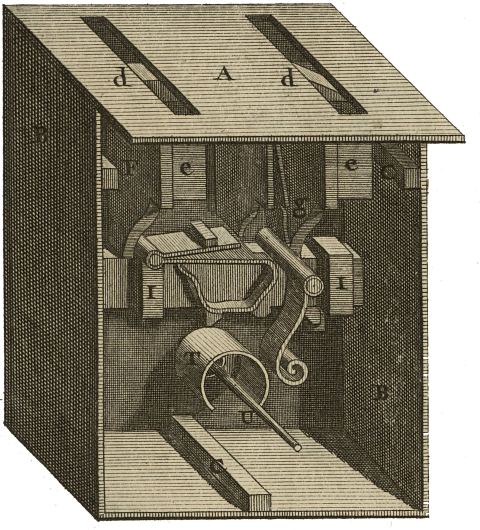

<div align="center" id="head">


<table>
<tr>
<td></td>
<td align="left">
<h1 style="margin:0">Tradomatic</h1>
<p style="margin:0.25em 0 0"><strong>Autonomous translation · Smart glossary</strong><br/>Recommended profile: philosophy DE → FR · Claude / Gemini · PyQt6</p>
</td>
</tr>
</table>

<a href="https://atelier.atechnologie.fr/" title="l'Atelier – book-making and research tools association"></a>  
<sub>Developed by <a href="https://atelier.atechnologie.fr/">l'Atelier</a> — book-making and research tools (EHESS)</sub>

<p>
🇫🇷 <a href="README.md">Français</a> ·
🇬🇧 <a href="README.en.md"><b>English</b></a> ·
🇩🇪 <a href="README.de.md">Deutsch</a> ·
🇪🇸 <a href="README.es.md">Español</a>
</p>

<p>
<a href="https://atelier.atechnologie.fr/"></a>
<a href="https://github.com/Atelier-Recherche/tradomatic"></a>
</p>

</div>

---

## 📸 Preview

| Translation | Glossary |
| :---: | :---: |
|  |  |

---
## 📖 About

Standalone text translator with a smart terminological glossary. Languages and domain are configurable — recommended profile: German → French philosophy.

---

## ⬇️ Installation

```bash
# Windows
python -m venv venv
venv\Scripts\activate
pip install -r requirements.txt

# Linux/Mac
python -m venv venv
source venv/bin/activate
pip install -r requirements.txt
```

---

## ✏️ Usage

```bash
python src/main.py
```

---

## ⚙️ Configuration

1. **Settings**: Choose API (Claude/Gemini), source/target languages, profile (e.g. philosophy DE → FR), enter API key, test connection, set paths
2. **Prompts**: Customize prompts (tags: `{glossaire_json}`, `{numero}`, `{contenu_markdown_page}`)
3. **Translation**: Start and follow progress
4. **Glossary**: View specialized terms in real time
5. **Comparison**: See source and translation side by side

---

## 📚 Glossary

The glossary contains **only complex specialized terms and concepts** automatically identified by the LLM in the `nouveaux_termes` section, not every word in the text.

---

## 🔁 Automatic resume

- The last project is loaded automatically at startup
- If translation is interrupted, it resumes where it stopped (already translated pages are skipped)

---

## 📋 Logs

All detailed logs (sent prompts, received responses, errors) are in:

- **Console**: real-time logs
- **File**: `logs/traduction_YYYYMMDD_HHMMSS.log` (full logs)

---

## 📁 Structure

```
tradomatic/
├── src/
│   ├── core/      # API, glossary, context, translation
│   ├── ui/        # PyQt6 interface (panels)
│   └── utils/     # i18n, config, logs
├── resources/     # UI translations, QSS themes
├── templates/     # Default prompts
└── logs/          # Log files
```

---

## 💰 Cost

- **Gemini**: Free (1500 req/day)
- **Claude Sonnet 4**: ~$43 for 700 pages

---

## 📄 License

MIT

---

## 🌐 Links

- 🌐 [l’Atelier](https://atelier.atechnologie.fr/)
- 📦 [GitHub repository](https://github.com/Atelier-Recherche/tradomatic)
