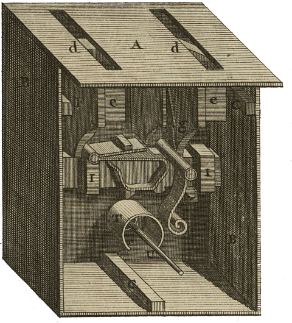

<div align="center" id="head">


<table>
<tr>
<td></td>
<td align="left">
<h1 style="margin:0">Tradomatic</h1>
<p style="margin:0.25em 0 0"><strong>Traducción autónoma · Glosario inteligente</strong><br/>Perfil recomendado: filosofía DE → FR · Claude / Gemini · PyQt6</p>
</td>
</tr>
</table>

<a href="https://atelier.atechnologie.fr/" title="l'Atelier – asociación de fabricación de libros y herramientas de investigación"></a>  
<sub>Desarrollado por <a href="https://atelier.atechnologie.fr/">l'Atelier</a> — fabricación de libros y herramientas de investigación (EHESS)</sub>

<p>
🇫🇷 <a href="README.md">Français</a> ·
🇬🇧 <a href="README.en.md">English</a> ·
🇩🇪 <a href="README.de.md">Deutsch</a> ·
🇪🇸 <a href="README.es.md"><b>Español</b></a>
</p>

<p>
<a href="https://atelier.atechnologie.fr/"></a>
<a href="https://github.com/Atelier-Recherche/tradomatic"></a>
</p>

</div>

---

## 📸 Vista previa

| Traducción | Glosario |
| :---: | :---: |
|  |  |

---
## 📖 Acerca de

Traductor autónomo de textos con glosario terminológico inteligente. Idiomas y dominio configurables — perfil recomendado: filosofía alemán → francés.

---

## ⬇️ Instalación

```bash
# Windows
python -m venv venv
venv\Scripts\activate
pip install -r requirements.txt

# Linux/Mac
python -m venv venv
source venv/bin/activate
pip install -r requirements.txt
```

---

## ✏️ Uso

```bash
python src/main.py
```

---

## ⚙️ Configuración

1. **Ajustes**: Elegir API (Claude/Gemini), idiomas origen/destino, perfil (p. ej. filosofía DE → FR), introducir clave API, probar conexión, definir rutas
2. **Prompts**: Personalizar los prompts (etiquetas: `{glossaire_json}`, `{numero}`, `{contenu_markdown_page}`)
3. **Traducción**: Lanzar y seguir el progreso
4. **Glosario**: Visualizar los términos especializados en tiempo real
5. **Comparación**: Ver fuente y traducción lado a lado

---

## 📚 Glosario

El glosario contiene **únicamente los términos especializados complejos y conceptos** identificados automáticamente por el LLM en la sección `nouveaux_termes`, no todas las palabras del texto.

---

## 🔁 Reanudación automática

- El último proyecto se carga automáticamente al arrancar
- Si la traducción se interrumpe, reanuda donde se detuvo (las páginas ya traducidas se ignoran)

---

## 📋 Logs

Todos los logs detallados (prompts enviados, respuestas recibidas, errores) están en:

- **Consola**: Logs en tiempo real
- **Archivo**: `logs/traduction_YYYYMMDD_HHMMSS.log` (logs completos)

---

## 📁 Estructura

```
tradomatic/
├── src/
│   ├── core/      # API, glosario, contexto, traducción
│   ├── ui/        # Interfaz PyQt6 (paneles)
│   └── utils/     # i18n, config, logs
├── resources/     # Traducciones UI, temas QSS
├── templates/     # Prompts por defecto
└── logs/          # Archivos de log
```

---

## 💰 Coste

- **Gemini**: Gratis (1500 req/día)
- **Claude Sonnet 4**: ~43$ por 700 páginas

---

## 📄 Licencia

MIT

---

## 🌐 Enlaces

- 🌐 [l’Atelier](https://atelier.atechnologie.fr/)
- 📦 [Repositorio GitHub](https://github.com/Atelier-Recherche/tradomatic)
