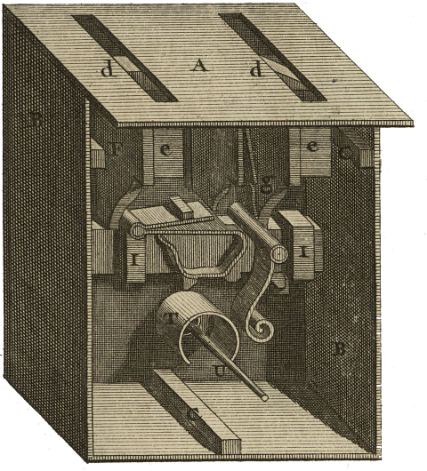

<div align="center" id="head">

<table>
<tr>
<td></td>
<td align="left">
<h1 style="margin:0">Tradomatic</h1>
<p style="margin:0.25em 0 0"><strong>Traduction autonome · Glossaire intelligent</strong><br/>Profil recommandé : philosophie DE → FR · Claude / Gemini · PyQt6</p>
</td>
</tr>
</table>

<a href="https://atelier.atechnologie.fr/" title="l'Atelier – Association de fabrication de livres et d'outils de recherche"></a>  
<sub>Développé par <a href="https://atelier.atechnologie.fr/">l'Atelier</a> — fabrication de livres et outils de recherche (EHESS)</sub>

<p>
🇫🇷 <a href="README.md"><b>Français</b></a> ·
🇬🇧 <a href="README.en.md">English</a> ·
🇩🇪 <a href="README.de.md">Deutsch</a> ·
🇪🇸 <a href="README.es.md">Español</a>
</p>

<p>
<a href="https://atelier.atechnologie.fr/"></a>
<a href="https://github.com/Atelier-Recherche/tradomatic"></a>
</p>

</div>

---

## 📸 Aperçu

| Traduction | Glossaire |
| :---: | :---: |
|  |  |

---
## 📖 À propos

Traducteur autonome de textes avec glossaire terminologique intelligent. Langues et domaine configurables — profil recommandé : philosophie allemand → français.

---

## ⬇️ Installation

```bash
# Windows
python -m venv venv
venv\Scripts\activate
pip install -r requirements.txt

# Linux/Mac
python -m venv venv
source venv/bin/activate
pip install -r requirements.txt
```

---

## ✏️ Utilisation

```bash
python src/main.py
```

---

## ⚙️ Configuration

1. **Paramètres** : Choisir API (Claude/Gemini), langues source/cible, profil (ex. philosophie DE → FR), entrer clé API, tester connexion, définir chemins
2. **Prompts** : Personnaliser les prompts (balises : `{glossaire_json}`, `{numero}`, `{contenu_markdown_page}`)
3. **Traduction** : Lancer et suivre la progression
4. **Glossaire** : Visualiser les termes spécialisés en temps réel
5. **Comparaison** : Voir source et traduction côte à côte

---

## 📚 Glossaire

Le glossaire contient **uniquement les termes spécialisés complexes et concepts** identifiés automatiquement par le LLM dans la section `nouveaux_termes`, pas tous les mots du texte.

---

## 🔁 Reprise automatique

- Le dernier projet est chargé automatiquement au démarrage
- Si la traduction est interrompue, elle reprend là où elle s’était arrêtée (pages déjà traduites sont ignorées)

---

## 📋 Logs

Tous les logs détaillés (prompts envoyés, réponses reçues, erreurs) sont dans :

- **Console** : Logs en temps réel
- **Fichier** : `logs/traduction_YYYYMMDD_HHMMSS.log` (logs complets)

---

## 📁 Structure

```
tradomatic/
├── src/
│   ├── core/      # API, glossaire, contexte, traduction
│   ├── ui/        # Interface PyQt6 (panneaux)
│   └── utils/     # i18n, config, logs
├── resources/     # Traductions UI, thèmes QSS
├── templates/     # Prompts par défaut
└── logs/          # Fichiers de log
```

---

## 💰 Coût

- **Gemini** : Gratuit (1500 req/jour)
- **Claude Sonnet 4** : ~43$ pour 700 pages

---

## 📄 Licence

MIT

---

## 🌐 Liens

- 🌐 [l’Atelier](https://atelier.atechnologie.fr/)
- 📦 [Dépôt GitHub](https://github.com/Atelier-Recherche/tradomatic)
